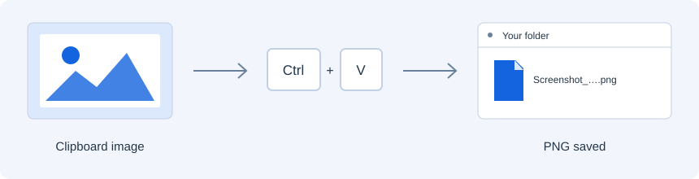

<div align="center">
  
  <h1>Laqay</h1>
  <p><strong>Paste it. Save it.</strong></p>
  <p>Clipboard image → PNG in your current Windows Explorer folder.<br>Just press <kbd>Ctrl</kbd> + <kbd>V</kbd>.</p>
  <p>Windows x64 · Portable · MIT</p>
  <p><a href="https://github.com/JAAvila-Of/laqay/releases"><strong>Download the engineering preview</strong></a> · <a href="docs/PORTABLE.md">Verify &amp; get started</a> · <a href="docs/integration-tests.md">Test coverage</a></p>
</div>




## Three steps. One familiar shortcut.

1. Extract the portable ZIP and launch `laqay.exe`.
2. Copy an image or take a screenshot.
3. Open a physical Explorer folder and press **Ctrl+V**.

Laqay saves `Screenshot_YYYYMMDD_HHMMSS.png` there. Existing files are never
overwritten; filename collisions receive a suffix. Supported images keep their
dimensions and available alpha. The diagram above is an illustration, not an
Explorer screenshot.

| In your workflow | Laqay's behavior |
| --- | --- |
| Image in the clipboard, physical Explorer folder | Save a PNG in that folder |
| Copied files, text, or a virtual-file transfer | Keep native paste behavior |
| Editable field, unsupported format, uncertain or virtual destination | Decline image conversion |
| No account or Internet connection | Operate locally, without telemetry or clipboard history |

## A small tray menu

| Menu item | What it does |
| --- | --- |
| **Enabled** | Turn image saving on or off; the icon becomes gray while disabled |
| **Start with Windows** | Register or remove startup for your account; off by default |
| **Exit** | Remove the tray icon and stop the application |

Keep the executable in a stable location if you enable startup. The
[portable guide](docs/PORTABLE.md) covers download verification, startup,
updates and removal. Normal use does not request administrator privileges.

## Engineering preview

The published v0.1.0 → v0.1.1 portable cycle passed 37 assertions in an isolated
Windows 11 Enterprise evaluation console, including upgrade, real-login startup
and removal. Separate desktop suites cover Explorer paste, native file/text
behavior, UNC, RDP clipboard transfer and selected lifecycle failures.

Recent isolated regression suites passed 37 cases on Windows 11, 12 basic
cases on Windows 10 Pro 22H2 (native file tabs do not apply), and 16 UNC cases.
Separate RDP suites passed with an earlier build of the same production logic.
Hosted CI also checks native clipboard conversion, publication cancellation,
disk-full and SMB recovery, and directed session-ending notifications.

**The full integration matrix remains incomplete.** Real shutdown with pending
work, additional context-change stages and the intermittent context rejection
tracked in [#41](https://github.com/JAAvila-Of/laqay/issues/41) retain explicit
limits. See the [integration matrix](docs/integration-tests.md) for the tested
sources and scope; these engineering previews are not a claim of 1.0 readiness.

## Build and contribute

Use stable Rust with the x86_64 MSVC toolchain, Visual Studio C++ Build Tools
and the Windows SDK resource compiler.

```sh
cargo fmt --all -- --check
cargo clippy --locked --all-targets --all-features -- -D warnings
cargo test --locked
cargo build --locked --release
```

The executable is `target/release/laqay.exe`. These build commands do not
authorize a live clipboard or desktop test.

- [Development and diagnostics](docs/DEVELOPMENT.md) — architecture, preferences, clipboard formats and bounded probes.
- [Automated tests](docs/AUTOMATED_TESTS.md) — native/API suites and their limits.
- [Contributing](CONTRIBUTING.md) — changes, reports and review expectations.
- [Release procedure](docs/RELEASING.md) — versions, changelogs, tags and releases managed by release-plz.

## Project information

[Report an issue](https://github.com/JAAvila-Of/laqay/issues/new/choose) ·
[Support](SUPPORT.md) · [Security](SECURITY.md) ·
[Governance](GOVERNANCE.md) · [Code of conduct](CODE_OF_CONDUCT.md)

MIT licensed. See [LICENSE](LICENSE), [third-party notices](THIRD_PARTY_NOTICES.md)
and [project identity](TRADEMARKS.md). Do not publish private clipboard contents
or unredacted diagnostic logs in public reports.
